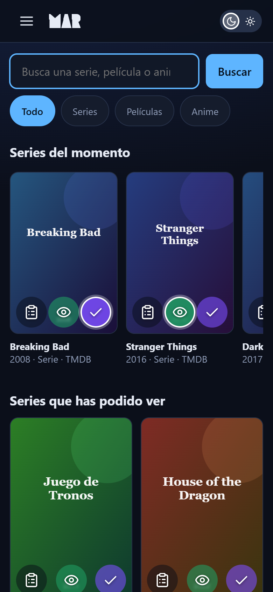
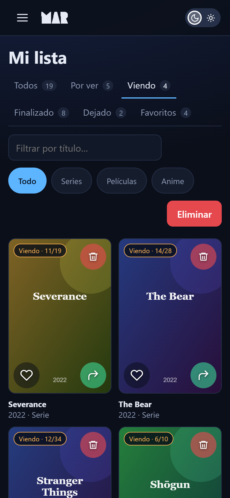
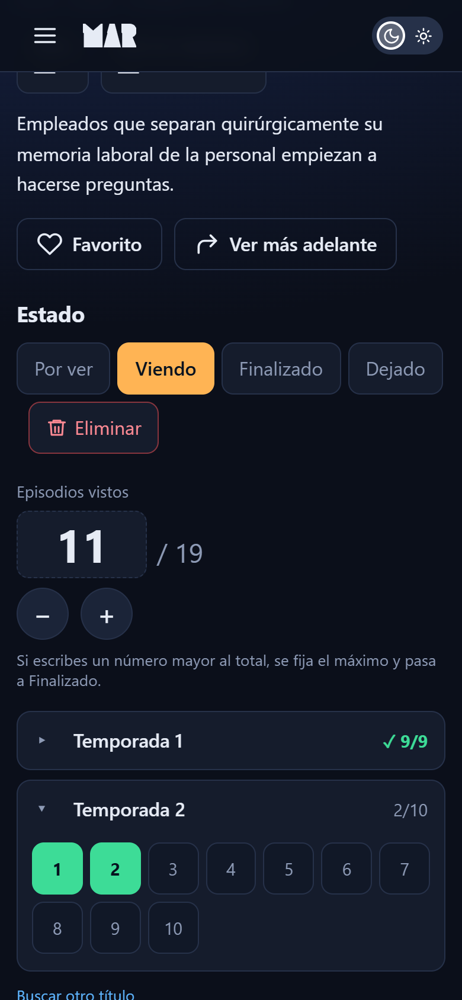
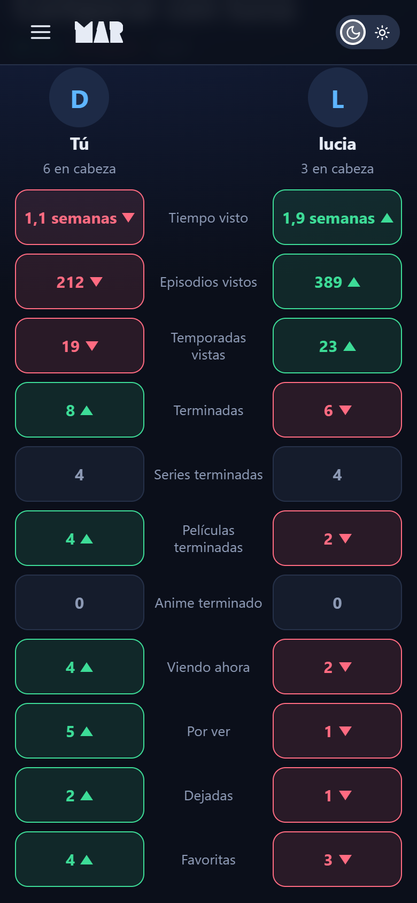
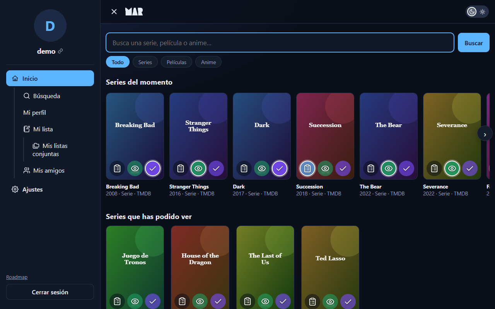
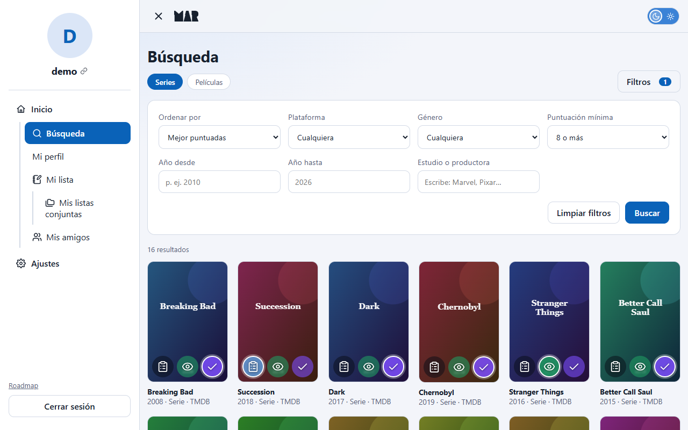
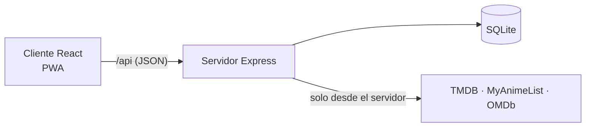

# MAR · Mis Apps Review

**Registro personal de series, películas y anime**: qué se ha visto, qué se está viendo y qué queda pendiente, con estadísticas, amigos, listas compartidas y recomendaciones. Aplicación web instalable (PWA) que funciona igual en el móvil y en el ordenador.


**Demostración en vivo:** https://mar.fly.dev · **Hoja de ruta pública:** https://mar.fly.dev/roadmap

<p align="center">
  
  
  
  
</p>
<p align="center">
  
  
</p>

> Las capturas usan datos ficticios y carátulas generadas (servidor simulado en modo demo).

## Qué ofrece

**Seguimiento**
- Busca series y películas (TMDB) y anime (MyAnimeList) desde un único buscador que responde mientras se escribe.
- Cuatro estados: *Por ver*, *Viendo*, *Finalizado* y *Dejado*, con botones directos sobre cada carátula, favoritos (máximo 10) y **revisionado** («Reviendo») sin perder lo ya visto.
- **Episodios por temporadas**: contador con − / + y la lista de episodios de cada temporada; pulsar uno fija el progreso.
- Fichas con sinopsis, estudio y puntuaciones de IMDb y Rotten Tomatoes.
- «Mi lista» con filtros por estado, tipo y título, y **scroll infinito** (carga por lotes, pensado para listas de cientos de contenidos).
- **Importar de MyAnimeList**: la lista de anime por nombre de usuario (listas públicas) o con el fichero de exportación de MAL (`.xml` / `.xml.gz`, también listas privadas). Vista previa con lo que se añade, se actualiza o queda igual antes de confirmar; si un anime ya estaba, se conserva lo más avanzado, y los revisionados de MAL cuentan en las estadísticas.

**Descubrir**
- **Recomendaciones** según los géneros con más afinidad: combinan la presencia del género en el mercado, en la lista de la persona y la cantidad de contenidos (los favoritos pesan más).
- **Búsqueda avanzada** con filtros combinables: plataforma (Netflix, HBO, Prime…), género, estudio, años, puntuación mínima y orden.

**Novedades**
- **Campana de notificaciones** con las novedades de lo que hay en la lista: nuevas temporadas (anunciadas o ya disponibles) y películas relacionadas (secuelas de una saga o spin-offs de una serie). Se calcula en segundo plano, sin ralentizar la aplicación; puede limitarse a los favoritos. Si una serie gana una temporada ya estrenada, el contenido finalizado vuelve a «Por ver» conservando lo visto; si TMDB retira una temporada o una película, se ajusta el progreso o se quita de las listas con un aviso.

**Estadísticas y social**
- Perfil con tiempo total visto (horas → días → semanas → meses → años), episodios, **temporadas vistas**, **revisiones** (veces que se ha vuelto a ver algo, con sus horas y episodios), contadores por estado y top 10 de favoritas.
- Perfiles con URL propia (`/perfil/<usuario>`): visibles solo para amigos o públicos; la lista, opcional.
- Amigos mediante solicitudes o **enlaces de amistad**; **comparación de perfiles** (verde quien tiene más, rojo quien tiene menos).
- **Listas conjuntas** por pareja de amigos, editables por ambos, con historial y *rollback*.

**Experiencia**
- **Tema claro y oscuro**, guardado en la cuenta.
- **PWA instalable** en Android e iPhone, con página sin conexión y aviso de versión nueva; menú lateral con gesto de deslizar en el móvil.
- Accesible: contraste AA en ambos temas, objetivos táctiles de 44 px, etiquetas para lectores de pantalla.
- Hoja de ruta pública en `/roadmap`, generada desde `roadmap/roadmap.json`.

### Instalar en el móvil

- **Android (Chrome):** abrir la aplicación → menú ⋮ → *Instalar aplicación*.
- **iPhone (Safari):** botón Compartir → *Añadir a pantalla de inicio* (debe ser Safari).

## Pila tecnológica

| Capa | Tecnología |
|---|---|
| Cliente | React 18, React Router 6, TypeScript, Vite 4, Lucide (iconos) |
| Servidor | Node.js 16, Express 4, TypeScript, zod (validación), helmet, bcrypt, JWT en cookie `httpOnly` |
| Datos | SQLite con `sql.js` (WebAssembly; sin dependencias nativas) y migraciones numeradas |
| Fuentes externas | TMDB (series y películas), API oficial de MyAnimeList (anime), OMDb (IMDb y Rotten Tomatoes) |
| Pruebas | Vitest (reglas de dominio, API completa con proveedores simulados, migraciones) |
| Despliegue | Docker (imagen única) en Fly.io, con volumen persistente |
| Monorepo | npm workspaces (`client` y `server`) |

## Arquitectura



El servidor es la única pieza que habla con los proveedores externos (con cachés, tiempos límite y corte automático de proveedores caídos), valida toda entrada y decide los permisos de perfiles y listas. Más detalle en [docs/ARQUITECTURA.md](docs/ARQUITECTURA.md).

## Puesta en marcha

Requisitos: **Node.js 16.20.x** y npm 8. No hay que compilar nada nativo.

```bash
git clone https://github.com/MiguelSanCar/MisAppsReview--MAR-.git
cd MisAppsReview--MAR-
npm install
cp .env.example .env      # añadir las claves de TMDB y OMDb
npm run dev
```

| URL | Qué |
|---|---|
| http://localhost:5173/ | Aplicación |
| http://localhost:5173/roadmap | Hoja de ruta |
| http://localhost:3001/api/health | Salud de la API |

Claves gratuitas: [TMDB](https://www.themoviedb.org/settings/api) (series y películas) y [OMDb](https://www.omdbapi.com/apikey.aspx) (puntuaciones). Sin ellas la aplicación arranca igualmente y lo indica; el anime funciona sin clave.

Para probar la interfaz sin claves ni Internet existe un **servidor simulado** (`npm run build && npm run dev:mock -w server`, en el puerto 3101). Ver la [guía de desarrollo](docs/DESARROLLO.md).

## Configuración

Variables de entorno principales (todas en `.env.example`):

| Variable | Descripción | Por defecto |
|---|---|---|
| `TMDB_API_KEY`, `OMDB_API_KEY` | Claves de las APIs | — |
| `JWT_SECRET` | Firma de sesiones (**obligatoria en producción**) | secreto de desarrollo |
| `PUBLIC_URL`, `CLIENT_ORIGIN` | URL pública y origen permitido (CORS) | `http://localhost:5173` |
| `DB_FILE` | Fichero SQLite | `data/mar.db` |
| `TMDB_REGION` | País para la disponibilidad en plataformas | `ES` |
| `MAL_CLIENT_ID` | Client ID de la API de MyAnimeList (anime); sin él no hay búsqueda de anime ni importación por nombre | — |
| `IMPORT_RATE_LIMIT` | Importaciones de MyAnimeList (vista previa, fichero o confirmación) por persona cada 15 minutos | `10` |
| `USE_REAL_RUNTIME` | Usar la duración real de las fuentes (por temporada en las series) en lugar de 50 / 90 / 23 min | `true` |

La lista completa está en [docs/DESPLIEGUE.md](docs/DESPLIEGUE.md).

## Scripts

| Comando | Qué hace |
|---|---|
| `npm run dev` | Servidor (3001) y cliente (5173) en desarrollo |
| `npm run build` | Compila cliente y servidor |
| `npm start` | Producción local (requiere `build`) |
| `npm test` | Pruebas del servidor |
| `npm run dev:mock -w server` | Aplicación con proveedores simulados |
| `npm run share` | Túnel temporal para enseñar el entorno de desarrollo |

## Pruebas

```bash
npm test
```

Más de 200 pruebas con Vitest: reglas de dominio puras, la API completa contra proveedores simulados con base de datos en memoria, permisos de perfiles y listas, migraciones, recomendaciones, búsqueda avanzada, comparación, temporadas, tema y PWA. Los cambios de interfaz se verifican además en un navegador real (ver la [guía de desarrollo](docs/DESARROLLO.md)).

## Despliegue

Imagen Docker única (API + cliente compilado) con un volumen en `/data` para la base de datos. Hay configuración lista para [Fly.io](https://fly.io) (`fly.toml`) y [Render](https://render.com) (`render.yaml`). Pasos, variables y operación en [docs/DESPLIEGUE.md](docs/DESPLIEGUE.md).

## Estructura del repositorio

```
client/    Interfaz: React + TypeScript + Vite (PWA)
server/    API, reglas de negocio, SQLite y pruebas
roadmap/   roadmap.json: fuente de verdad de la hoja de ruta pública
scripts/   Arranque conjunto (dev), túnel (share) y capturas
docs/      Documentación (ver abajo)
Dockerfile, fly.toml, render.yaml   Despliegue
```

## Documentación

| Documento | Contenido |
|---|---|
| [docs/ARQUITECTURA.md](docs/ARQUITECTURA.md) | Componentes, datos, reglas de negocio, seguridad |
| [docs/API.md](docs/API.md) | Referencia de endpoints |
| [docs/DESARROLLO.md](docs/DESARROLLO.md) | Entorno, pruebas, convenciones y solución de problemas |
| [docs/DESPLIEGUE.md](docs/DESPLIEGUE.md) | Publicación y operación |
| [docs/DECISIONES.md](docs/DECISIONES.md) | Decisiones técnicas y su motivo |
| [docs/CHANGELOG.md](docs/CHANGELOG.md) | Historial de versiones |
| [docs/THIRD_PARTY_LICENSES.md](docs/THIRD_PARTY_LICENSES.md) | Licencias y atribuciones de terceros |

## Versiones y hoja de ruta

Versionado semántico: arreglos `x.y.Z`, funcionalidades nuevas `x.Y.0`, cambios incompatibles `X.0.0`. Cada versión está descrita en el [CHANGELOG](docs/CHANGELOG.md) y el trabajo pendiente y hecho, por fases, en la [hoja de ruta](https://mar.fly.dev/roadmap).

Limitaciones conocidas:
- Las horas vistas usan la duración real: la de la película, la media de cada temporada en las series (estimada con una muestra de episodios de TMDB) y la del anime. Si falta el dato, o con `USE_REAL_RUNTIME=false`, se usa la fija (serie 50 min, película 90, anime 23).
- El anime no tiene estructura de temporadas ni recomendaciones (MyAnimeList no ofrece esos datos de forma fiable).
- El envío de correo está preparado pero no activo: «recuperar contraseña» y «verificar correo» escriben el enlace en el registro del servidor.

## Créditos y atribuciones

- Datos de series y películas: [TMDB](https://www.themoviedb.org). *This product uses the TMDB API but is not endorsed or certified by TMDB.*
- Puntuaciones: [OMDb API](https://www.omdbapi.com). Anime: [API de MyAnimeList](https://myanimelist.net/apiconfig/references/api/v2).
- Iconos: [Lucide](https://lucide.dev) (licencia ISC).
- El logotipo usa los glifos de la fuente *Lock Block* de Sronstudio, de uso personal: ver [docs/THIRD_PARTY_LICENSES.md](docs/THIRD_PARTY_LICENSES.md) antes de cualquier uso comercial.
- Desarrollado con la asistencia de [Claude Code](https://claude.com/claude-code).

## Licencia

Este repositorio no declara una licencia de código abierto: se aplican los derechos de autor por defecto. Los componentes de terceros conservan sus propias licencias.
