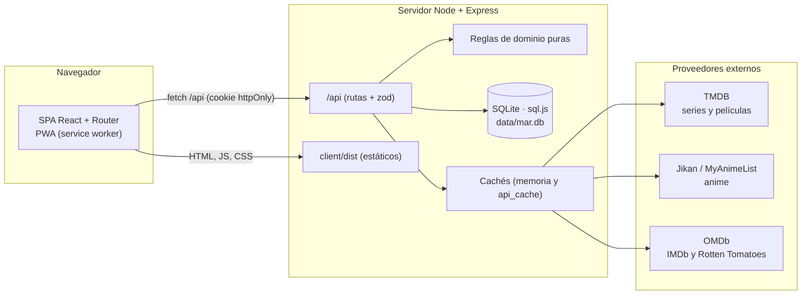
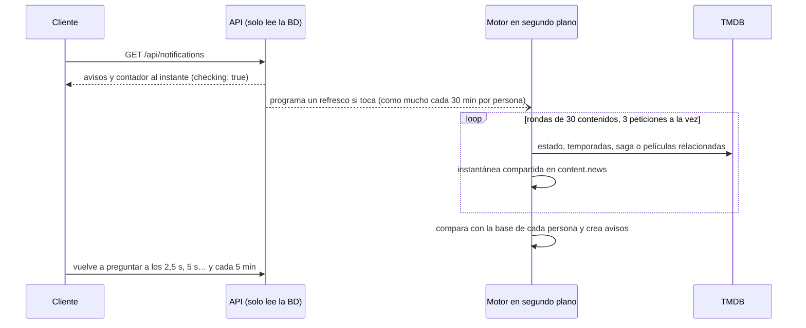

# Arquitectura

Visión técnica de MAR: componentes, datos, reglas de negocio y decisiones de diseño. Las razones de cada decisión están en [DECISIONES.md](DECISIONES.md) y la referencia de endpoints en [API.md](API.md).

## Visión general

Monorepo con **npm workspaces**: un cliente web (SPA) y un servidor que expone una API JSON, sirve el cliente compilado y persiste en **SQLite**.



Los proveedores externos **solo se llaman desde el servidor**: el navegador nunca ve las claves de API ni depende de su disponibilidad.

## Estructura del código

```
client/src
├─ App.tsx              Rutas (pantallas poco frecuentes con carga diferida)
├─ api.ts               Cliente HTTP (ApiError, cancelación con AbortController)
├─ auth/                Contexto de sesión
├─ theme/               Tema claro/oscuro (contexto, persistencia)
├─ profile/             Contexto y envoltorio de /perfil/:usuario
├─ pwa/                 Registro del service worker y aviso de versión nueva
├─ hooks/               useSwipeMenu (gesto táctil del menú lateral)
├─ notifications/       Contexto de la campana (lectura, repreguntas y ajustes)
├─ components/          Layout, PosterCard, CardRow, SeasonList, NotificationBell, ThemeSwitch, Logo…
├─ pages/               Inicio, Búsqueda avanzada, Mi lista, Ficha, Perfiles, Amigos, Listas, Ajustes, Roadmap
└─ styles.css, index.css  Estilos globales y variables de tema

server/src
├─ app.ts               Middleware (helmet/CSP, CORS, cookies), rutas, estáticos y manejador de errores
├─ config.ts            Configuración (se lee en cada uso: los tests la modifican)
├─ db.ts, migrations.ts SQLite con sql.js y migraciones numeradas
├─ cache.ts, http.ts    Cachés, cliente HTTP con tiempos límite y corte de proveedores caídos
├─ providers/           tmdb.ts, jikan.ts, omdb.ts (resultados normalizados)
├─ content.ts           Búsqueda, tendencias, ficha, géneros y temporadas
├─ library.ts           Biblioteca personal (paginación por cursor, contadores)
├─ profile.ts, compare.ts  Estadísticas y comparación de perfiles
├─ recommendations.ts   Recomendaciones por géneros
├─ news.ts              Motor de novedades (notificaciones) en segundo plano
├─ structure.ts         Sincroniza temporadas y películas retiradas de TMDB con el progreso (desde el motor de novedades)
├─ runtimes.ts          Duración real de los episodios (medias por temporada) en segundo plano
├─ listLife.ts, mailer.ts, roadmap.ts
├─ domain/              Reglas puras sin red ni BD: rules, time, recommend, seasons, news, structure, runtimes
└─ routes/              auth, account, library, discover, recommendations, friends, invites, profiles, lists
```

## Datos

SQLite con `sql.js` (WebAssembly): la base vive **en memoria** y se vuelca a `data/mar.db` 300 ms después de cada escritura. Por eso solo puede haber **un proceso por fichero**. Las migraciones están numeradas (hoy 13) y nunca se edita una publicada.

| Tabla | Contenido |
|---|---|
| `users` | Cuenta, avatar, visibilidad del perfil, tema (`theme`), verificación de correo |
| `content` | Series, películas y anime vistos o buscados alguna vez: datos de la ficha, `genres` (JSON), `seasons` (JSON), puntuaciones |
| `user_content` | Estado de cada persona sobre cada contenido: `status`, `watched_episodes`, `prev_episodes`, `rewatch`, `is_favorite`, `updated_at` |
| `api_cache` | Caché persistente de respuestas externas (fichas, OMDb, géneros, plataformas) |
| `friendships`, `invite_links` | Amistades (solicitada/aceptada) y enlaces de amistad |
| `joint_lists`, `joint_list_members`, `joint_list_items`, `joint_list_history` | Listas conjuntas, sus miembros, contenidos e historial para el rollback |
| `auth_tokens` | Tokens de un solo uso (recuperar contraseña, verificar correo) |
| `notifications` | Avisos de novedades por persona (`dedupe_key` única, `seen_at`) |
| `content.news`, `user_content.news_base` | Instantánea de novedades de cada contenido (compartida) y lo que ya se conocía cuando la persona lo añadió |

## Proveedores externos y resiliencia

- **TMDB** (series y películas): búsqueda, tendencias, ficha (con géneros y temporadas), `/discover` (recomendaciones y búsqueda avanzada), plataformas y estudios. **Jikan** (anime). **OMDb** (IMDb y Rotten Tomatoes).
- Todos los resultados se normalizan a un mismo formato (`ProviderItem`) y se guardan en `content` para no volver a pedirlos.
- **Cachés**: las búsquedas y los listados de descubrimiento en memoria (`memCached`, con deduplicación de peticiones en vuelo); las fichas, OMDb, géneros y plataformas en `api_cache` (`cached`; si el proveedor falla se sirve el dato caducado antes que ninguno).
- **`guarded()`** corta un proveedor caído (1 min, duplicando hasta 15 min; se reinicia al responder) y la búsqueda espera como máximo `tmdbSoftMs` (6 s) y `jikanSoftMs` (2 s) devolviendo lo que ya tenga, con avisos en pantalla.

## Reglas de negocio

- **Estados**: Por ver, Viendo, Finalizado, Dejado. **Favorito** (máximo 10) = Finalizado con todos los episodios; quitarlo solo lo saca de favoritos.
- **Episodios**: enteros; llegar o superar el total fija el máximo y finaliza. Una película cuenta como 1 episodio.
- **Tiempo visto** = minutos de los episodios vistos. Series: se suma la media de cada temporada (`Season.minutes`, ver «Duración de los episodios»); película y anime: su duración; si falta el dato o `USE_REAL_RUNTIME=false`, la fija (serie 50 min, película 90, anime 23). Se muestra en horas → días → semanas → meses → años.
- **Duración de los episodios**: TMDB no da una duración fiable por serie, sino por episodio y temporada. Para no hacer decenas de peticiones se muestrea (`domain/runtimes.ts`): en una temporada «larga» (más de 3N episodios) se toman sus primeros N episodios y su media es la de esa temporada; las temporadas «cortas» no se consultan una a una: se toman N episodios de las primeras y su media vale para todas ellas. N = `RUNTIME_SAMPLE` (4). Lo que no se pudo medir usa la media de lo medido y, si no hay nada, la duración fija. Se calcula en segundo plano (`runtimes.ts`: concurrencia global de 2, máximo 12 peticiones por serie, caché de 30 días) al abrir la ficha de una serie y al ver un perfil con series sin calcular; nada espera a ello.
- **Revisionado**: volver a ver algo finalizado lo pasa a «Por ver» con los episodios a 0 y se muestra «Reviendo»; lo ya visto se conserva en `prev_episodes` y sigue contando en las estadísticas.
- **Temporadas**: el progreso sigue siendo un número de episodios; las temporadas son una vista sobre él. «Temporadas vistas» cuenta las completas.
- **Perfiles**: `/perfil/<usuario>`, solo para amigos por defecto o públicos; la lista solo si se permite; los amigos de alguien nunca son públicos. Todo el acceso se decide en `resolve()` (`routes/profiles.ts`).
- **Amistad**: el enlace propio añade como amigo a quien lo abre; el de otro perfil solo envía una solicitud.
- **Listas conjuntas**: una por pareja; salir no la borra; se borra tras 60 días sin actividad con aviso en la aplicación 15 días antes; cada cambio queda en un historial con rollback.
- **Recomendaciones**: afinidad por género según presencia en el mercado, en la lista y cantidad (ver DECISIONES).

## Notificaciones de novedades



- **Qué avisa**: temporada nueva *anunciada* o *disponible* de una serie, y película nueva de la misma saga (si el contenido es una película) o **película relacionada** de una serie (spin-off), esta última por una heurística de título (ver DECISIONES).
- **Base de comparación**: al empezar a seguir un contenido se guarda lo que ya existía (`news_base`); solo lo posterior es novedad, así que añadir una serie con diez temporadas no genera diez avisos.
- **Rendimiento**: la lectura es una consulta indexada; el cálculo nunca bloquea una petición. Cola con límite global de peticiones simultáneas a TMDB, rondas pequeñas que ceden el turno, instantánea compartida entre personas y caducidades por tipo (series en emisión 12 h; terminadas y películas 7 días; búsqueda de películas relacionadas 7 días). Un fallo se reintenta a los 15 min.
- **Estructura de temporadas** (`structure.ts`, reglas puras en `domain/structure.ts`): una vez por contenido, sin peticiones extra. Si una serie gana una temporada ya estrenada (con episodios y fecha pasada), se actualizan `content.seasons` y `total_episodes` y, en cada persona y cada lista conjunta que la tiene, lo Finalizado pasa a «Por ver» conservando los episodios vistos (Viendo/Por ver no cambian, Dejado se respeta, el favorito se conserva). Si TMDB retira una temporada, se restan solo sus episodios vistos y, si no falta ninguno, pasa a Finalizado, con el aviso `season_removed`. Solo cuentan cambios de temporadas, no los episodios sueltos que sume una temporada en emisión; las temporadas solo anunciadas siguen siendo un aviso.
- **Película retirada**: si TMDB responde 404, `removeMovie` la quita de `user_content` y `joint_list_items` y crea el aviso `movie_removed`; el contenido sigue en `content`.
- **Contenidos solo en listas conjuntas**: el motor también los refresca, sin generar avisos de novedades para ellos.
- **Ajustes**: «solo favoritos» se aplica al leer (no al calcular), por lo que activarlo o quitarlo es inmediato.

## Seguridad

- Sesión con **JWT en cookie `httpOnly`** (`Secure` si la petición llegó por HTTPS; `trust proxy` = `loopback` en local y `1` en producción). Contraseñas con **bcrypt**. Limitación de intentos en autenticación.
- **Validación** de toda entrada con **zod**; errores con `HttpError(status, mensaje)` y mensajes en español.
- **helmet** con CSP estricta (`default-src 'self'`, sin scripts en línea; imágenes solo propias y de TMDB/MyAnimeList). Por eso el tema se aplica con un script externo mínimo (`theme-init.js`).
- Permisos de perfiles y listas comprobados en el servidor; los datos privados (correo, tema, contraseñas) nunca viajan en perfiles ajenos.
- Secretos solo en variables de entorno; `.env`, `data/`, `certs/` y `tools/` están en `.gitignore`.

## Cliente

- **React 18** con **React Router 6**; las pantallas poco frecuentes se cargan bajo demanda (`React.lazy`).
- **Listas largas**: paginación en el servidor con cursor de teclado `(updated_at, id)`, carga al acercarse al final (`IntersectionObserver`), tarjetas memoizadas y `content-visibility: auto`.
- **Tema**: variables CSS y `data-theme` en `<html>`; preferencia por usuario guardada en la cuenta y en el navegador.
- **PWA**: manifiesto, iconos, service worker a mano (caché de la cáscara y de `/assets`; nunca `/api`), página sin conexión y aviso de versión nueva. Cabeceras de caché: `/assets` inmutables; `index.html`, `sw.js` y el manifiesto con `no-cache`.
- **Móvil**: menú lateral como cajón con gesto de deslizar, objetivos táctiles de 44 px con puntero táctil, zonas seguras y altura dinámica (`dvh`).

## Despliegue

Imagen Docker única (API + cliente compilado) con el volumen persistente en `/data`. Publicada en Fly.io: ver [DESPLIEGUE.md](DESPLIEGUE.md).
